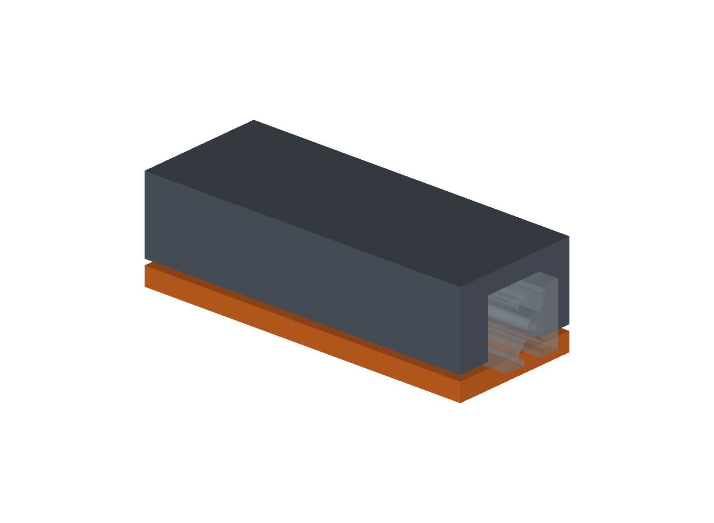
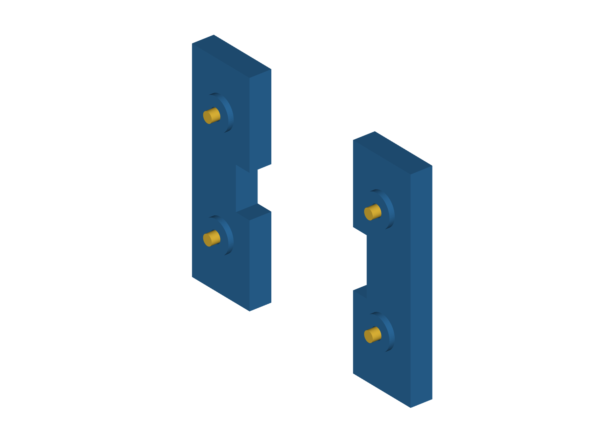

# 2020 Extrusion-Mounted Touch Display — Parametric V005

**Actual CadQuery BREP solids, STEP assemblies, STL component exports and CAD-derived previews.**

This is a *provisional engineering prototype*, based on the user's original tabletop stand photos and revised Freeform side-profile sketch and corrected side-profile sketches. Its saddle is centered at the display carrier's front/rear datum Y=0, with its inside bearing face perpendicular to the carrier. The curved supporting arms extend behind the upright display, not diagonally beneath an inclined tabletop stand. The 120 mm × 20 mm × 20 mm extrusion solid is the **exact user-supplied `2020-2O_rail.step`**, rigidly rotated into the assembly. Its two opposing T-slots are now on the +Z/top and −Z/bottom faces.

**There are no claimed measurements of the real touchscreen, PCB hole pitch, stand angle or physical rail fit.** Those values are editable initial candidates in [`config/mount_spec.json`](config/mount_spec.json). Do not print and install this on a running printer without measuring and validating those interfaces.

## V005 — centered upright carrier and curved, slot-keyed mount

- **Display carrier vertical (90°)** to the saddle's inner horizontal bearing face, not V001's provisional 46° inclination.
- **Centered**: the carrier's lower/front Y datum, rail section center, and saddle centerline share **Y = 0 mm**; all three are also centered across X.
- **Both complete triangular support arms rebuilt** with an open web extending rearward behind the upright carrier, still integrated into one solid main frame.
- **Existing physical reference STEP unchanged**, oriented by the original rigid 120° assembly transform; upper saddle and removable lower keeper retain their M4 hole patterns.
- Four M2.5 candidate display board mounting stations and straight rear driver paths retained. Dimensional values remain provisional until physical measurements.

The orthogonal and centering acceptance gates can be relaxed explicitly for a future revised configuration by setting `require_perpendicular_display` or `require_display_centering` to `false`. They remain enabled for this release. [Engineering datum explanation](docs/V002_ALIGNMENT.md).

## V005 — curved Freeform-matched support and T-slot indexing

The V002 hard triangle has been replaced by **two sculpted parametric arms** with rounded top shoulder, swept upper diagonal, rear transition, tapered lower leg, curved bottom corners, sloping front toe, and tall vertical rounded obround access window. These are real CadQuery BREP arcs and cuts, not a picture or faceted trace.

The saddle remains centered beneath the screen with its inside horizontal bearing plane perpendicular to the upright carrier, and the **centered top-slot indexing key is now enabled**: 5.6 mm mouth width, 75 mm along the rail, 0.9 mm downward projection. Its collision with the actual supplied STEP rail is checked on every build. The metal M4 lower keeper still provides load retention; the locating tongue is not the primary clamp mechanism.

The PCB's four M2.5 candidate fasteners and rear screwdriver corridors are preserved. Display/stand dimensions are **provisional** until caliper measurements are provided. See [V003 profile contract](docs/V003_PROFILE.md).

## V005 — tangent-continuous compact profile

The side-arm's front foot now starts at the saddle's actual front Y datum (minus half the 42 mm saddle width). There is **no projecting rounded toe**. The rear lower foot is shortened and the rear transition is narrowed. Three mathematically constructed circular fillets connect the top shoulder, rear turn and lower rear foot to neighboring straight lines with **G1 tangency**; the circles are defined by exact tangent offsets, not approximated by arbitrary three-point arcs. The front-to-saddle foot junction is a flush shared edge, not a cosmetic unsupported overhang. All dimensions remain provisional pending physical measurements.

The rail's original STEP, 90° centered carrier, locating T-slot key, M4 keeper, and rear-accessible M2.5 board fasteners are unchanged.

## V005 — lower rear gusset and profiled service opening

The lower rear overhang is no longer an unsupported horizontal shelf: each side arm has a structural triangular gusset extending downward from the rear saddle wall into the rearward support foot. The gusset is fused into the arm and overlaps the saddle wall without entering the 2020 rail or removable keeper. Its depth and overlap are controlled by `arm_gusset_saddle_overlap_mm` and `arm_gusset_bottom_relief_mm`.

The side service opening is a **rounded trapezoid**, replacing the oversized rear-shifted vertical capsule. Its forward wall is referenced to the display datum; the rear wall leans inward at the top to broadly follow the exterior diagonal. Its front offset, bottom/top Z stations, rear wall bottom/top Y stations, and fillet radius are independently editable in the configuration. All four corners are analytic fillets.

## Geometry-derived previews

### Full assembly (blue translucent rectangle is only a provisional display envelope)


### Complete one-piece structural frame: two triangular arms, upright carrier, top saddle


### Side orientation and 2020 clamp




### Screw mounting and rear accessibility




## Solid-model deliverables

| Item | STEP | STL | Meaning |
|---|---|---|---|
| **Full assembly** | [`COMPLETE_2020_TOUCHSCREEN_ASSEMBLY_V005.step`](step/COMPLETE_2020_TOUCHSCREEN_ASSEMBLY_V005.step) | — | Import into Onshape: rail, complete main frame, lower keeper, notional screen envelope and fastener references |
| **Main structural frame** | [`main.step`](step/main.step) | [`main.stl`](stl/main.stl) | One-piece: both full triangular arms + upright carrier + upper clamp |
| **Lower keeper** | [`keeper.step`](step/keeper.step) | [`keeper.stl`](stl/keeper.stl) | Removable clamp jaw with four nominal M4 passages |
| 2020 rail reference | [`rail.step`](step/rail.step) | — | The original imported STEP, *rigidly rotated* into assembled orientation |
| **Printable pair** | [`PRINTABLE_PARTS_V005.step`](step/PRINTABLE_PARTS_V005.step) | — | Main + keeper only, excludes rail, display and hardware |
| Front carrier design isolation | [`carrier.step`](step/carrier.step) | [`carrier.stl`](stl/carrier.stl) | *Reference subsolid; already fused into the main body* |
| Left and right arms | [`left_arm.step`](step/left_arm.step), [`right_arm.step`](step/right_arm.step) | `stl/left_arm.stl`, `stl/right_arm.stl` | *Reference subsolids; already fused into main body* |
| Upper clamp design isolation | [`upper_saddle.step`](step/upper_saddle.step) | [`upper_saddle.stl`](stl/upper_saddle.stl) | *Reference subsolid; already fused into main body* |
| Small display screw references | [`M2_5_DISPLAY_SCREWS_REFERENCE.step`](step/M2_5_DISPLAY_SCREWS_REFERENCE.step) | — | Four nominal M2.5 fastener envelopes, schematic |
| Clamp screw references | [`M4_CLAMP_SCREWS_REFERENCE.step`](step/M4_CLAMP_SCREWS_REFERENCE.step) | — | Four nominal M4 fastener envelopes, schematic |

The **only intended printable structural components are `main` and `keeper`**. Do not print the other component isolations as a complete separate kit; they represent portions of the main body, and no independent part-to-part fasteners for them have been designed.

## Parametric manufacturing contract

| Parameter | V005 candidate | Status |
|---|---:|---|
| Imported rail length | 120 mm | **Verified from supplied STEP** |
| Imported extrusion bounding cross-section | 20 × 20 mm | **Verified from supplied STEP** |
| Rail slots | +Z and −Z in assembled coordinates | **STEP reference geometry** |
| Main clamp span along rail | 108 mm | Provisional |
| Side clearance relative to 20 mm rail | 0.35 mm per side | Provisional |
| Two triangular arm center spacing | 78 mm | Provisional |
| Arm thickness | 8 mm | Provisional |
| Display inclination above horizontal | 90° | User-specified perpendicular geometry |
| Display frame width | 176 mm | Provisional |
| Display frame length along slope | 80 mm | Provisional |
| PCB mounting hole pattern | X = ±28 mm, sloped station S = 30 or 61 mm | **Unmeasured** |
| Display small holes | Ø2.8 mm, counterbore Ø5.8 mm | M2.5 candidate, verify |
| Display PCB standoffs | Ø9 × 5 mm | Provisional |
| Underside clamp fasteners | Four M4 clearance bores + upper-body insert pockets | M4 candidate, verify insert dimensions |
| Rear straight-tool clearance | Ø6 mm envelope from all 4 stations | CAD check passed; real driver not verified |

All positions use a right-handed frame: **X across the screen/along the rail, Y front-to-rear, Z upward**. The carrier uses `S` measured along the carrier from its lower/front edge, not global Y or Z. The display mounting bosses project toward the screen along the normal of the carrier plate. Screws enter from the **rear** through the carrier and pass toward the PCB. Whether your board holes are tapped, through-holes for small nuts, or require heat-set inserts still needs measurement.

### Why this fastening approach

- **Screen:** four small, replaceable screws through the support's central PCB interface, with circular rear head counterbores. The four screwdriver-axis cylinders are checked against the entire completed support frame. There are no hidden screws trapped behind an inaccessible solid support.
- **Extrusion:** the top saddle + *separate lower keeper* capture the 20 × 20 rail. Four M4 candidate screws pass from below into proposed heat-set-insert pockets in the saddle legs, providing mechanical retention without putting printed retention clips in tension. A nominal side/top clearance prevents CAD contact; tightening force and actual fit remain physically unverified.
- **No forced slot family:** because the supplied 2020 T-slot profile is provisional, the mount currently uses the rail's external rectangular envelope rather than relying on unverified T-nut dimensions. The top slot locating tongue is **enabled** and verified collision-free against the supplied rail STEP; physical fit remains unverified.

## Generate or revise all CAD from parameters

Python 3.10+ and CadQuery 2.4+ required. VTK is used for actual CAD preview PNGs (previews optional); no FreeCAD, Onshape API or external services required.

`/src/build.py`

```bash
python -m pip install -r requirements.txt
# Rebuild STEP, STL, validation JSON, and geometry-derived PNGs
xvfb-run -a python src/build.py
# On a machine without Xvfb, generate solids only:
python src/build.py --no-previews
# Run the regression tests
python -m unittest discover -s tests -v
```

To revise after taking caliper measurements, edit [`config/mount_spec.json`](config/mount_spec.json) and regenerate. The generator rejects invalid or disconnected BREP parts, body/rail overlap, and obstructed straight rear screwdriver access.

**Important distinction:** STEP is a solid-model exchange format. Onshape imports editable solid *bodies*, but does **not** recover a native Onshape parametric feature history from a STEP. The authoritative parametric history lives in `src/build.py` plus `config/mount_spec.json`; regen creates a new STEP to reimport. The model can also be used as a mating reference for native Onshape sketches and features.

## Onshape import (iPhone or desktop)

1. Import [`step/COMPLETE_2020_TOUCHSCREEN_ASSEMBLY_V005.step`](step/COMPLETE_2020_TOUCHSCREEN_ASSEMBLY_V005.step) into your `2020-extrusion-mounted-display` document.
2. Leave **Y-axis up** unchecked. The model's +Z is up, +X runs along the reference rail.
3. The assembly contains **rail reference**, **full main stand**, **lower keeper**, **provisional display envelope**, and **screw references**. Do not confuse reference solids with parts to print.
4. For manufacturing, import `main.step` and `keeper.step` independently as well, or slice `stl/main.stl` and `stl/keeper.stl` after measured-fit acceptance.
5. Keep a new Onshape sketch or mate reference aligned to the actual *existing* rail, and verify the Neptune 2 frame's available clamp envelope and moving axis clearance.

## Physical qualification required before use

- Measure the real PCB screw-hole locations, hole diameter, thread/through-hole type, connector clearance, screen dimensions, and screen center of gravity.
- Measure the actual Neptune 2 top rail external dimensions, slot topology, corner radii, accessible mounting span and existing frame fasteners. The imported 2020 STEP is an **unverified proxy** for the physical printer's upper rail.
- Confirm front/back orientation, tilt, visibility, bed/toolhead clearance, wire routing, heat exposure, fastener torque, insert fit, print orientation and layer direction. Check loads during fast printer motion.
- Print a short clamp-fit coupon before printing the full stand. Do **not** treat CAD checks as a load/fatigue or print-qualification test.

See [`docs/validation.json`](docs/validation.json), [`docs/FIT_REGISTER.csv`](docs/FIT_REGISTER.csv), [`docs/BOM.csv`](docs/BOM.csv) and [`docs/PROVENANCE.md`](docs/PROVENANCE.md).
