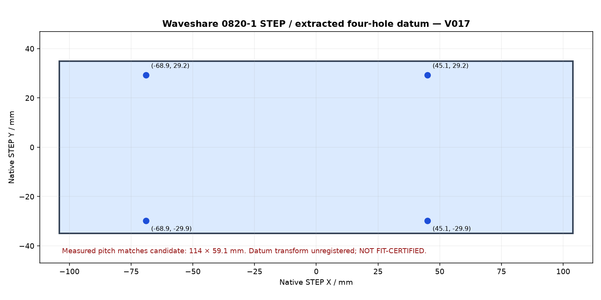
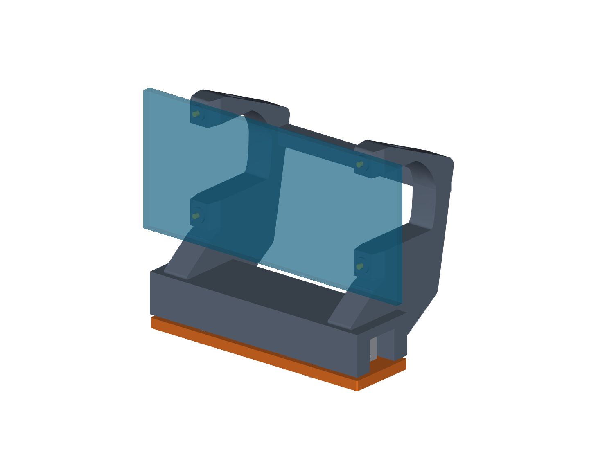
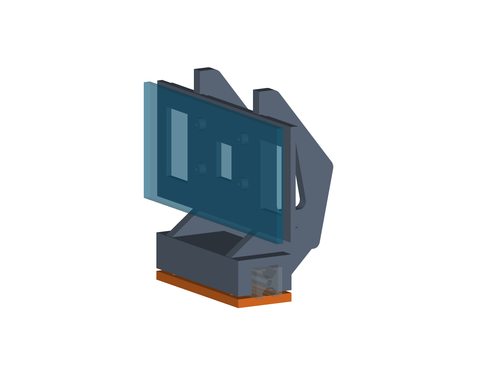

# Neptune 2 · Parametric 2020 Extrusion Display Mount · V013

## V013 — expanded curved U arms and enclosed rear-driver access

The mounting arms now have **deeper, taller R6 service reliefs**: the nominal central aperture grows from Z64–86/Y40–30 to Z63–88/Y45–36. These are actual subtractive CAD solids, not decorative surface features. The front M3 mounting positions are unchanged: nominal Z53 and Z98, with 10 mm of vertical distance to the opening. The Ø7 screwdriver passage radius plus the 4 mm minimum screw-web and 2 mm transition allowance constrain the cutout envelope.

The interior rear slope now has a separately parameterized **8 mm minimum nominal Y-direction web at both opening ends**. Both 3D rear-entry Ø7 tool passages extend through the outside of their own arm and beyond its measured bounding box (no accidental blind tunnels). The screw-head seats remain separate Ø6.4 counterbores with 3.2 mm nominal axial bearing floors, and only Ø3.4 shank bores enter the board-facing surface. Changing the screw pitch or position still drives the opening extents.

**Fit limitation:** the actual Waveshare source STEP four-pad pitch is 114 × 59.1 mm (Ø2 holes), whereas this existing bracket remains a provisional 78 × 45 mm M3 model. This structural design change does not certify the physical monitor fit.


See [V013 design and acceptance criteria](docs/V013_ARM_CUTOUTS_AND_REAR_ACCESS.md).


**Current design: one integral structural display mount + one removable M4 keeper.** The curved side arms are the vertical PCB mounting rails. There is no intervening carrier, rear display sheet, or transverse screw-tab attachment. All four M3 mounting holes and their rear driver corridors are machined parametrically into the **main structural arm BREP**.

The 20 × 20 × 120 mm two-face-slotted reference extrusion is the original unmodified `reference/2020-2O_rail.step`, rigidly positioned along X. The saddle index key enters its existing upper slot. The main frame is centered on the rail and holds the screen upright at 90° to the saddle's inside horizontal bearing face.

> **Provisional engineering model:** display, PCB hole coordinates, M3 head type/length, SD slot and USB connector clearance are not physically measured. Do not treat a nominal BREP collision pass as real-world fit or strength approval.

## V013 — unified service opening and hardware datum

The V011 opening was made by fusing a rounded quadrilateral pocket to an additional slot-shaped front cutter, producing unwanted shelves and bulbous transitions. V013 generates **one open-front filleted U cutter per arm**, with only the G1-rounded rear corners left visible in the frame. Its lower and upper edges follow the M3 stations and their minimum support envelopes. Front-neck side removal now grows progressively through an eight-millimeter lofted root transition instead of beginning in an abrupt Z=37 mm flat ledge.

**Waveshare reference from uploaded `0820-1.stp`:** BREP cylinder centers at X=-68.9/+45.1 and native Y=-29.9/+29.2 mm. The four circled mounting holes have Ø2.0 cylindrical surfaces and coaxial Ø5.5 cylindrical boss surfaces. Native center pitches are 114.0 × 59.1 mm, offset X=-11.9 mm from the source bounding-box center. See [exact datum manifest](reference/waveshare_0820_1_mounting_datums.json), [fit-status documentation](docs/V013_WAVESHARE_FIT_AND_PROFILE.md), and [Waveshare hole-pattern STEP fixture](step/WAVESHARE_0820_DATUM_FIXTURE.step).

**Critical physical-fit gate:** The published bracket's existing screw pattern remains **78 × 45 mm** and the canonical 2020 rail remains **120 mm long**. Its nominal display plane is also narrower than the STEP source's 208 mm X span. These are unresolved dimensional incompatibilities, not merely fillet errors. The reference model is supplied as a *non-printable datum fixture*, not silently adapted into a bracket. Hardware-registration mode fails closed pending an approved XZ orientation, rail-length/mount load path, boss engagement and connector clearances.



## V013 — M3 fastener-driven structural side profile

V013 fixes the key failure in V010: the M3 screw pitch could change while the service opening and rear load-bearing gusset retained fixed Z boundaries. The vertical stations are now authoritative geometric parents for the **upper and lower service-opening boundaries, rear contour and exterior gusset height**. These changes propagate through both structural arms.

The side aperture is constrained by the Ø7 rear driver passage plus a configurable **4 mm nominal minimum support web**, an additional 2 mm transition allowance, and the corner radius. When a fastener station changes, the opening and upper arm height follow it; when the requested pitch is infeasible, generation fails rather than silently creating unsupported M3 tabs.


The front SD/USB throat center is now *clamped to the adaptive opening interval*, retaining the original nominal center when geometrically feasible. The upper rear web is computed by interpolation between the actual outer shoulder and bulge rather than by extrapolation. The tapered cavity roof is not expanded into the rear load-bearing diagonal. The default opening offsets are 11/12 mm respectively.

Actual board spacing, SD/USB port geometry and load paths still require physical measurement. The new checks are nominal BREP geometry constraints, not printed strength certification.

See [V013 structural dependency design](docs/V013_SUPPORT_DEPENDENCIES.md).

## V013 — compact, rounded and parametric

The structural arms themselves remain the only display carrier. Each front M3 region is narrowed from 16 mm to a **12 mm minimum-width neck** using two parametric drafted side cuts that blend back into the full 16 mm rear structural arm. The upper end now stops 9.5 mm above the upper fastener axis instead of carrying an oversized vertical tab. The side-profile nose, front root and upper cap use analytic tangent arcs; the removable M4 keeper has softened exterior corners. M3 bore/head-seat dimensions, bearing floor, rear tool access, SD/USB opening and keyed extrusion datums are preserved.

See [V013 engineering changes](docs/V013_GEOMETRY.md). Screw positions and actual PCB clearances remain provisional.

## Geometry-derived previews

Every image below is rendered from the generated CAD geometry and committed to the repository with the STEP/STL files.

**Complete assembly** — translucent blue rectangle is a provisional display bounding reference, not a printable plate.



**One-piece structural frame** — both arm faces carry their own M3 screw mounting interfaces.


**Integral M3 mounting and driver access** — these are arm features, not separate rail parts.


**Engineering side profile**, including open front service access and preserved rear slope.


**Assembly side angle and lower 2020 clamp.**




## Single-piece mounting architecture

The sculpted arms comprise the entire rear PCB mounting structure, tapering from a 12 mm front face to the original 16 mm rear structural web. Their center spacing and the mounting-hole X spacing are independent config variables, but any relative offset must preserve the minimum material around all driver passages.

Each M3 station contains a centered Ø3.4 mm forward through-bore, an internal Ø6.4 mm head seat, and an axial Ø7 mm driver/head passage that continues toward the rear. The forward screw-head bearing floor remains 3.2 mm thick by default (3.0 mm minimum); the radial wall is validated against the complete arm thickness. No rectangular PCB backing plane, separate mounting carrier, rail step, or outboard screw tabs are manufactured.

The front-opening cutter is unified for each arm; SD and USB service corridors are tested separately against the actual 3D cut volume. Its open throat spans the screw-derived U aperture, while the diagonal back rib remains uninterrupted. To keep both M3 seats out of that open service throat, their temporary vertical coordinates are now S=20 and S=65 mm. **These screw locations are construction candidates, not measurements of your PCB.**

| Config key | Default | Purpose |
|---|---:|---|
| `support_arm_center_spacing_mm` | 78 mm | Symmetric arm X pitch |
| `arm_thickness_mm` | 16 mm | Full structural arm width |
| `arm_front_rail_side_trim_mm` | 2 mm per side | Tapered front M3 neck to 12 mm |
| `arm_front_rail_taper_depth_mm` | 8.5 mm | Smooth draft back into 16 mm web |
| `upper_boss_cap_extra_mm` | 9.5 mm | Upper end measured from high screw axis |
| `arm_front_top_fillet_mm` | 2 mm | Tangent arc around upper/front cap |
| `arm_front_foot_fillet_mm` | 2 mm | Tangent arc at front/base junction |
| `arm_toe_radius_mm` | 1.5 mm | Curved lower nose |
| `keeper_corner_fillet_mm` | 1 mm | Exterior keeper vertical-edge rounds |
| `mount_hole_center_spacing_mm` | 78 mm | M3 hole X pitch; constrained to arm material |
| `board_screw_station_center_mm` | 42.5 mm | Vertical fastener midpoint, S datum |
| `board_screw_vertical_pitch_mm` | 45 mm | Two M3 Z stations per arm |
| `board_screw_clearance_d_mm` | 3.4 mm | M3 through-hole |
| `board_screw_head_access_d_mm` | 6.4 mm | Internal head seat diameter |
| `board_driver_access_d_mm` | 7.0 mm | Continuous rear insertion corridor |
| `mount_pad_axial_thickness_mm` | 6.2 mm | Front seat plus head depth |
| `board_counterbore_depth_mm` | 3.0 mm | M3 head seat axial depth |
| `min_screw_head_floor_mm` | 3.0 mm | Required front bearing floor |
| `min_screw_head_radial_wall_mm` | 2.5 mm | Required side arm material |
| `display_angle_deg` | 90° | Mount upright relative to 2020 saddle |

The right-handed coordinate system is X along extrusion/screen width, Y front-to-back, Z upward. `S` is vertical distance upward from the support front datum at Z=33 mm. The side holes and the arm outer profile are symmetric about X=0; both service branches remain separately configurable.

## Manufacturing and Onshape files

| Item | STEP | STL | Role |
|---|---|---|---|
| **Integrated main frame** | [main.step](step/main.step) | [main.stl](stl/main.stl) | One 3D-printable structural body with four integral M3 pockets |
| **Removable lower keeper** | [keeper.step](step/keeper.step) | [keeper.stl](stl/keeper.stl) | Second printable body, with M4 clamp channels |
| Full V013 reference assembly | [assembly](step/COMPLETE_2020_TOUCHSCREEN_ASSEMBLY_V013.step) | — | Main + keeper + source rail + screen envelope + screw references |
| Printable two-body assembly | [main + keeper](step/PRINTABLE_PARTS_V013.step) | — | Only actual intended printed parts |
| Arm diagnostics | [left](step/left_arm.step) · [right](step/right_arm.step) | — | Subsolids already included in main; **do not print separately** |
| 2020 STEP reference | [rail](step/rail.step) | — | Real supplied section, rigidly oriented |
| Display M3 screw references | [M3 screws](step/M3_DISPLAY_SCREWS_REFERENCE.step) | — | Provisional hardware visualization |

Onshape: import the V013 full assembly STEP with **Y-axis up unchecked** (+Z is up). It provides independent editable solids, but parametric feature history remains in [src/build.py](src/build.py) and [config/mount_spec.json](config/mount_spec.json), not in Onshape's imported STEP feature tree.

## Regeneration

`/src/build.py`

```bash
python -m pip install -r requirements.txt
xvfb-run -a python src/build.py
python -m unittest discover -s tests -v
```

Changes to CAD geometry must commit updated STEP/STL, all rendered previews and [docs/validation.json](docs/validation.json). [V013 integral-arm design contract](docs/V013_INTEGRAL_ARMS.md) distinguishes the screen-facing bore, head-seat shoulder and rear insertion corridor.

**Measure before printing:** actual PCB hole X/Z pitch and thread type, M3 head profile and effective engagement, display/port extents, printer top rail slots and clearances, nozzle/bed motion envelope, torque, load direction and printed-layer strength.
