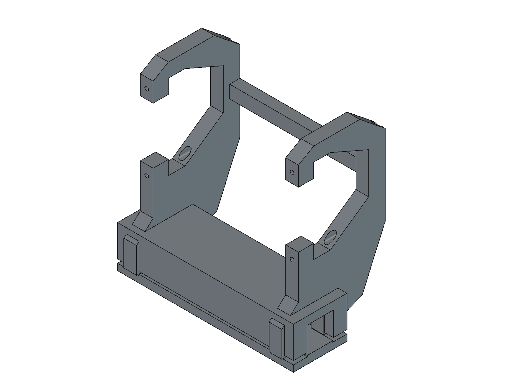

# Preserved FreeCAD source

`display-mount-original.FCStd` is the editable checkpoint imported from the user's saved `display-mount.FCStd`. `original-brackets.step` and `original-side.png` show the checkpoint's two separate bracket solids; they are references, not a completed printable mount.

The Assembly contains a Body whose active tip is `Pocket001`: the YZ Sketch (28 elements, fully constrained) drives Pad; MultiTransform mirrors it; XY Sketch drives Pocket; Binder supplies Pocket001. The unused TabOpeningSketch and TabOpeningPocket remain in the tree, but are not the active tip. MountingParams supplies 114 mm X pitch, 59.1 mm Z pitch, 10 mm face width, 15 mm tab height, 10 mm pad depth, 4 mm datum offset, 12 mm tab projection, 13 mm access depth, 5 mm nominal web, 2 mm upper taper inset and 6 mm upper root reinforcement.

At import, Pocket001 contains two valid disconnected solids with combined bounds X −62…62, Y −13…68, Z −88.2789…44.05 mm. It does not yet include the connecting saddle or keeper.

## Connected working model

`display-mount-working.FCStd` preserves the original bracket Body and adds editable saddle and rear cross-member features, insert pockets, a separate keeper and a final `MountPrintable` fusion. The cross member follows the upper rear web and is flush with the outside arm faces. The original 6 mm notch key conflicted with the supplied rail STEP; the working model narrows it to 5.8 mm about the rail center. The original file remains unchanged.

The keeper is 138 × 42 × 6 mm, spans the saddle, and has four 4.5 mm clearance holes aligned to 5.5 mm insert pockets. Shallow reliefs under the bracket feet allow the modeled keeper to reach the rail before bearing on the feet. Its initial gap to the reference rail is 0.30 mm. Four 4.4 mm bolt-path probes were unobstructed; a 0.31 mm keeper translation reaches the rail without colliding with the mount. These geometric checks do not establish actual clamping force or hardware fit.

At 53, 59.1 and 65 mm vertical pitch the native fused mount and separate keeper were valid single solids; modeled rail and keeper overlap were zero. The nominal main bounds are 138 × 81 × 132.33 mm, within the configured Neptune 2 base profile's 235 × 235 × 250 mm build volume. This is a bounding-box check only. The upper cross member and arm interiors may require supports depending on orientation; no slicer analysis has been performed.

The Python generator retains a different curved arm profile and coordinate system. Its lower root-relief and front-neck blend previously rejected 65 mm pitch. The generator now shortens those transitions as the lower screw descends and locates its cross member at the upper rear web. Its full validation passed at 53, 59.1 and 65 mm; its round bosses, 16 mm arms and curved opening remain different from the native 10 mm arms and angular opening. STEP and STL files marked `working` are CAD review exports; the keeper remains a separate part.

